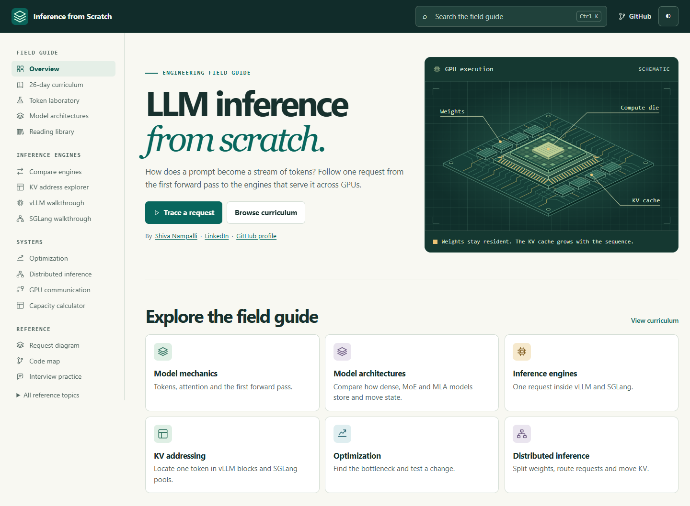
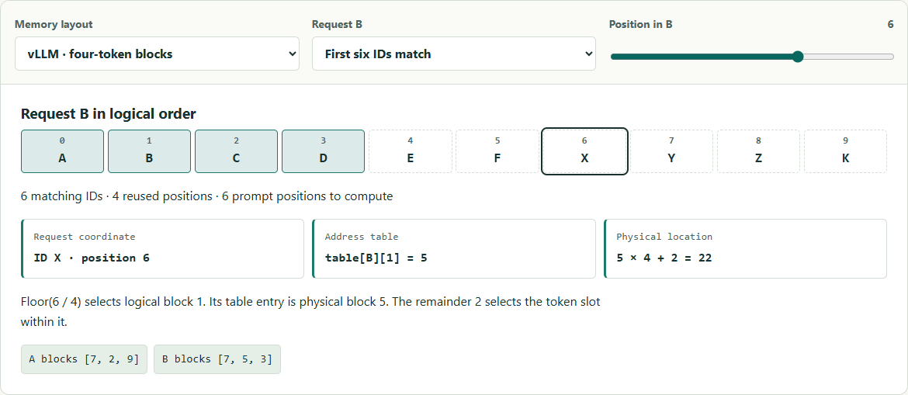
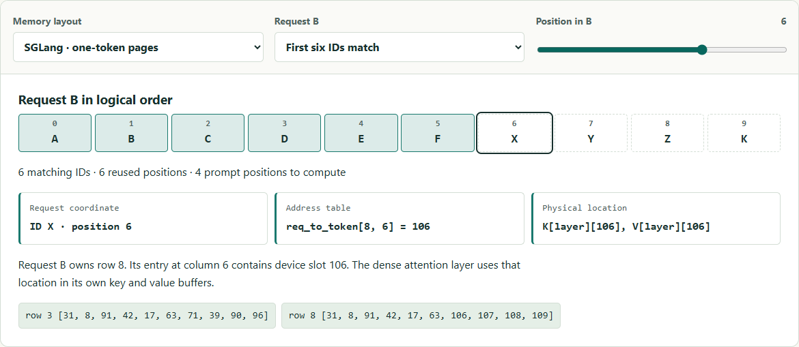
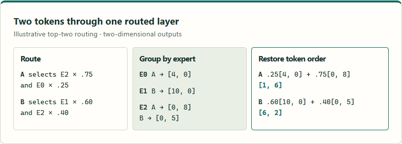
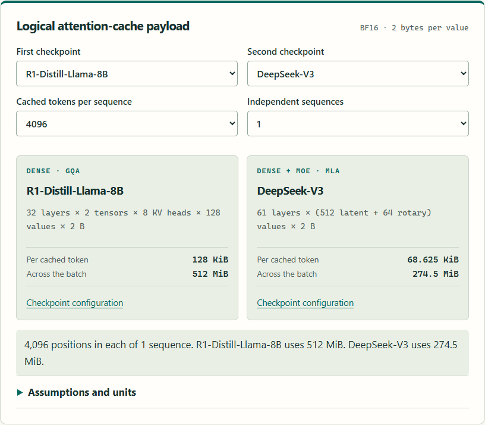

# LLM Inference from Scratch

Trace one prompt from token IDs to a streamed reply, then follow the same work across GPUs.
The repository pairs an executable Python engine with an interactive field guide to vLLM,
SGLang, model architectures, and distributed inference.

**[Open the live field guide](https://siddhu1716.github.io/LLM_Inference_from_scratch/)** · [26-day curriculum](https://siddhu1716.github.io/LLM_Inference_from_scratch/curriculum.html) · [Run the Python model](#quickstart)

[](https://siddhu1716.github.io/LLM_Inference_from_scratch/)

## Inside the labs

**Where does one token live?** Two prompts share six leading IDs. In the four-token,
whole-block vLLM example, the first four positions are reusable. At position 6, table entry
1 points to physical block 5, giving slot 22. Switch to SGLang’s one-token-page example:
all six leading positions are reusable, and request row 8 maps position 6 to slot 106.
The explorer also covers paged SGLang allocation, vLLM’s finer-grained prefix hits,
and HiCache fetches from host memory and storage. [Open the KV address explorer](https://siddhu1716.github.io/LLM_Inference_from_scratch/engines/memory.html#address-lab)

| vLLM block table | SGLang request-to-token pool |
| --- | --- |
|  |  |

**Which bytes move when a model is distributed?** Follow a tensor collective,
a pipeline-stage send, a replica-local request, and an expert dispatch. Compare a
prefill/decode KV handoff with the activation traffic at each attention/FFN split.
Check the model, connector, layout, and hardware assumptions before applying the
bandwidth estimate. [Open the distributed walkthrough](https://siddhu1716.github.io/LLM_Inference_from_scratch/systems/fabric.html)



**Why does architecture change the cache budget?** Compare five checkpoints, trace
grouped-query and latent attention, and see how full DeepSeek-R1 differs from the
distilled models. Open the companion visualizer to inspect DeepSeek-V3 layer by layer.
[Open the model atlas](https://siddhu1716.github.io/LLM_Inference_from_scratch/models/index.html) · [DeepSeek Visualizer](https://siddhu1716.github.io/deepseek_visualizer/)

<details>
<summary>See the model cache comparison</summary>



</details>

The Python examples use small inputs and untrained weights. The guide labels recorded
model output, illustrative engine traces, and calculated communication estimates.
[Implementation scope](https://siddhu1716.github.io/LLM_Inference_from_scratch/index.html#limitations)

## What you can learn here

- Follow a request through admission, prefill, decode, sampling, streaming,
  metrics, and cleanup.
- Compare the same decoder-only Transformer architecture in dependency-free
  Python and `torch.nn`.
- Inspect RMSNorm, RoPE, grouped-query attention, SwiGLU, causal masking, and
  incremental KV caching without a framework hiding the steps.
- Run continuous batching, token-budget and cache-aware scheduling, chunked
  prefill, paged allocation, and longest-prefix reuse on tiny inputs.
- Study executable versions of online-softmax attention, quantization,
  speculative decoding, LoRA, MoE routing, structured decoding, and
  parallelism plans.
- Practice **110 inference-engine interview questions**, including 20 on vLLM
  and SGLang internals, in the searchable GitHub Pages site.
- Watch animated **vLLM and SGLang token lifecycles** that show every process
  hop and the exact source files triggered at each step.
- Follow a **26-day curriculum** with notebooks from *100 Days of Inference*,
  worked examples, and links to the corresponding Python implementations.

## Feature matrix

| Area | Learning-scale implementation |
|---|---|
| Model | Decoder-only Transformer, embeddings, RMSNorm, RoPE, GQA/MHA, SwiGLU |
| Backends | Pure Python nested lists and PyTorch `torch.nn` |
| KV cache | Transparent per-layer cache plus paged-cache simulation |
| Decoding | Greedy, temperature, categorical, top-k, top-p, min-p, typical |
| Logit controls | Bias, repetition, frequency, and presence penalties |
| Search/stopping | Beam search, stop tokens, and stop sequences |
| Request engine | Lifecycle, prefill/decode phases, token budgets, continuous batching |
| Memory | Block allocator, paged KV cache, radix-style longest-prefix cache |
| Scheduling | Chunked prefill and cache-aware ordering |
| Observability | Streaming events, TTFT, ITL, and throughput metrics |
| Attention optimization | Exact FlashAttention-style tiled online softmax reference |
| Quantization | Symmetric weight-only INT8 and grouped packed INT4 |
| Speculation | Exact rejection sampling and an n-gram proposer |
| Adaptation/routing | LoRA linear adapter and top-k MoE routing |
| Scale-out concepts | Tensor, pipeline, data, expert, and context partition plans |
| Serving architecture | Prefill/decode disaggregation router and static-shape graph cache |
| Structured output | Token DFA and a small JSON-object constraint |
| API | `/health`, `/v1/models`, `/v1/completions`, `/v1/chat/completions`, SSE |
| Documentation | Static field guide, model replay, engine walkthroughs, capacity calculator, reading library, and 110 Q&As |

GPTQ, AWQ, FlashAttention GPU kernels, CUDA Graph capture, NCCL collectives,
and RadixAttention kernels are explained but not falsely presented as
production implementations. Their small counterparts expose the core idea and
invariants.

## Quickstart

Python 3.10 or newer is required.

```powershell
Set-Location "C:\path\to\LLM_Inference_from_scratch"
python -m venv .venv
.\.venv\Scripts\Activate.ps1
python -m pip install -e ".[all]"
python -m pytest
```

Run the tiny **untrained** pure-Python model:

```powershell
mini-infer sample "Hello" --max-new-tokens 8 --seed 7
```

The output is random-model bytes, not useful prose; the purpose is to inspect
the complete autoregressive and KV-cache path.

Run the walkthroughs:

```powershell
python examples\compare_backends.py
python examples\engine_walkthrough.py
python examples\optimization_walkthrough.py
```

Start the OpenAI-style demo server:

```powershell
mini-infer serve --port 8000
curl http://127.0.0.1:8000/health
```

## Repository map

```text
src/mini_infer/
|-- common/          # validated model config and reversible byte tokenizer
|-- backends/
|   |-- python/      # matrix loops and dependency-free Transformer
|   `-- torch/       # matching torch.nn Transformer
|-- decoding/        # one sampling/search/penalty technique per file
|-- engine/          # requests, scheduling, batching, caches, metrics
|-- optimizations/   # executable math and systems simulations
|-- serving/         # stdlib HTTP, schemas, chat template, SSE
`-- cli.py
tests/               # deterministic unit and integration tests
examples/            # runnable learning walkthroughs
docs/                # no-build GitHub Pages site and interview bank
|-- notes/           # four long-form beginner textbook volumes
|-- engines/         # engine lifecycles, source traces, KV addresses and HiCache
|-- models/          # checkpoint configurations, attention shapes and expert routing
|-- systems/         # memory, GPU placement and communication worksheets
`-- reading/         # annotated notebooks, papers and engineering articles
```

Each technique has its own file so it is easy to revisit in isolation.

## Suggested learning path

1. **Model math:** `common/config.py`, then the paired backend files in this
   order: embedding, RMSNorm, RoPE, attention, MLP, block, model.
2. **Token selection:** start with `decoding/logits.py`, then greedy and
   categorical sampling before adding filters and penalties.
3. **Token loop:** read `engine/request.py`, `phases.py`, `scheduler.py`,
   `batching.py`, and finally `sync_engine.py`.
4. **Memory:** compare the model's transparent KV cache with
   `block_allocator.py`, `paged_kv_cache.py`, and `prefix_cache.py`.
5. **Optimizations:** run each file in `optimizations/` beside its tests.
6. **Serving:** trace schemas through `http_server.py`, SSE, and metrics.
7. **Review:** use the website's interview filters to explain tradeoffs aloud.

## 26-day inference engineering curriculum

The website now includes a chronological curriculum that complements the
topic-oriented reference guide:

1. **Days 1-5 — mechanics:** generation, tokenization, embeddings, attention,
   and KV caching.
2. **Days 6-12 — performance and runtimes:** arithmetic intensity, CUDA
   kernels, model formats, PagedAttention, RadixAttention, TensorRT-LLM, and
   NVIDIA Dynamo.
3. **Days 13-18 — optimization and scale-out:** number formats, GPTQ/AWQ/
   SmoothQuant, speculative decoding, prefix caching, parallelism, and
   prefill/decode disaggregation.
4. **Days 19-26 — production engineering:** GPU memory hierarchy and
   generations, MIG, containers, cold starts, autoscaling, queueing, routing,
   multi-cloud capacity, cost, and zero-downtime deployment.

Each day includes goals, theory, a checkpoint question, and a link to the
closest executable module in this repository. The material is independently
written as a study synthesis; it does not reproduce book prose.

The short curriculum cards link to four full beginner textbook volumes:

- **Days 1-5:** tensors, logits, sampling, tokenization, embeddings, attention,
  RoPE, GQA, and KV caching.
- **Days 6-12:** roofline analysis, CUDA kernels, model formats, vLLM, SGLang,
  TensorRT-LLM, and serving control planes.
- **Days 13-18:** numerical formats, quantization, speculation, prefix caching,
  parallelism, and disaggregated serving.
- **Days 19-26:** GPU hardware, MIG, containers, autoscaling, queueing,
  multi-cloud capacity, deployment, observability, and cost.

Together, the four volumes contain approximately **48,000 words**, more than
130 glossary terms, worked examples, equations, diagrams, answered review
questions, exercises, decision guides, failure scenarios, and capstones. Each
day also links to attributed reference diagrams and further reading.

## vLLM and SGLang deep dives

The `docs/engines/` pages explain how production engines serve one request:

- **Engines overview:** side-by-side process layouts and a 15-step mapping of
  equivalent vLLM and SGLang source files.
- **vLLM deep dive:** API server, AsyncLLM, EngineCore, scheduler, KV cache
  manager, GPU model runner, sampler, detokenizer, and feature catalog.
- **SGLang deep dive:** TokenizerManager, scheduler event loops, RadixCache,
  memory pools, ForwardBatch, ModelRunner, DetokenizerManager, and feature
  catalog.

Each lifecycle is interactive: play, pause, or step through admission,
prefill, repeated decode iterations, and completion while watching the streamed
output and cumulative list of files touched. Engine implementation links are pinned to these
snapshots so the explanations do not drift:

| Engine | Commit | Snapshot date |
|---|---|---|
| vLLM | `7b77ed581d92fa14e34ab43344837bb1ca1b4257` | 2026-10-31 |
| SGLang | `07a85353d6c6be47a268e33a416ad537985ef262` | 2026-10-31 |

External images are embedded only when their licenses permit redistribution;
other diagrams are linked with attribution.

## Validation

```powershell
python -m pytest
ruff check .
```

Tests cover backend shapes and cache equivalence, deterministic decoding,
request-state and allocator invariants, cache matching and eviction,
attention equivalence, quantization error, speculative acceptance/rejection,
parallel plans, structured decoding, and HTTP behavior.

## Documentation and GitHub Pages

Start at the [field guide](https://siddhu1716.github.io/LLM_Inference_from_scratch/). The **Token laboratory** replays three
prompts through the repository’s untrained Python model with seed 7 and greedy
decoding. Each pass shows the input IDs, KV positions and top three raw logits.
The reproduction command beside each trace runs the same model locally.

- The [engine comparison](https://siddhu1716.github.io/LLM_Inference_from_scratch/engines/index.html#request-lab) follows one
  illustrative request in vLLM and SGLang. Switch the prefix-cache state or
  disconnect the client, then follow the linked implementation chapters.
- The [distributed inference lab](https://siddhu1716.github.io/LLM_Inference_from_scratch/systems/index.html) connects memory
  sizing to optimization choices, GPU placement, KV transfers and measurements.
- The [reading library](https://siddhu1716.github.io/LLM_Inference_from_scratch/reading/index.html) pairs research papers, engine
  documentation, *100 Days of Inference* notebooks and engineering articles
  with questions to investigate.
- The [request diagram](https://siddhu1716.github.io/LLM_Inference_from_scratch/index.html#request-diagram) includes editable
  Mermaid and Excalidraw downloads.

Serve the site locally:

```powershell
python -m http.server 8000 --directory docs
```

Then open <http://localhost:8000>. For GitHub Pages, select **GitHub Actions**
as the Pages source; `.github/workflows/pages.yml` publishes `docs/` directly
with no build dependencies.

## Production-engine mapping

This project takes inspiration from:

- [vLLM documentation](https://docs.vllm.ai/) and the
  [PagedAttention paper](https://arxiv.org/abs/2309.06180)
- [SGLang documentation](https://docs.sglang.ai/) and the
  [SGLang paper](https://arxiv.org/abs/2312.07104)
- [FlashAttention](https://arxiv.org/abs/2205.14135)
- [RoFormer / RoPE](https://arxiv.org/abs/2104.09864)
- [Grouped-Query Attention](https://arxiv.org/abs/2305.13245)
- [Speculative Decoding](https://arxiv.org/abs/2211.17192)
- [GPTQ](https://arxiv.org/abs/2210.17323),
  [AWQ](https://arxiv.org/abs/2306.00978), and
  [SmoothQuant](https://arxiv.org/abs/2211.10438)
- [Megatron-LM](https://arxiv.org/abs/1909.08053)
- [100 Days of Inference](https://github.com/elizabetht/100-days-of-inference)
  companion curriculum

The names help connect study code to production vocabulary; they do not claim
feature or performance parity.

## Author

Shiva Nampalli · [Portfolio](https://shivanampalli.netlify.app/) · [GitHub](https://github.com/siddhu1716) · [LinkedIn](https://www.linkedin.com/in/shiva-nampalli/)

## License

MIT. See [LICENSE](LICENSE).
